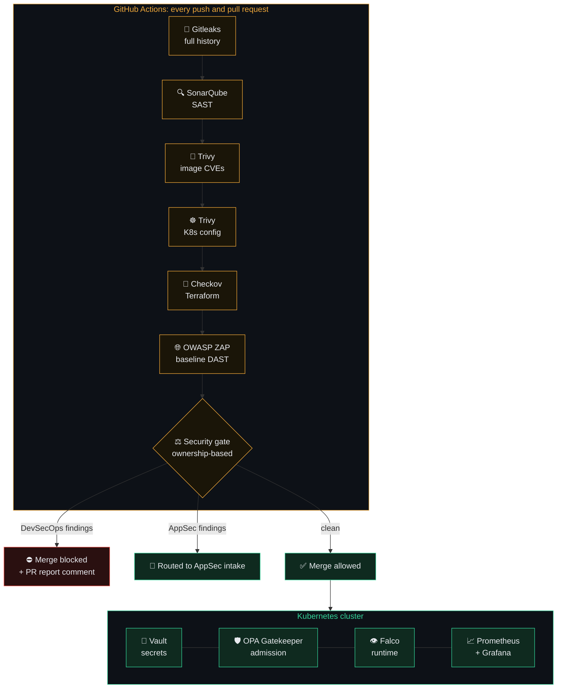
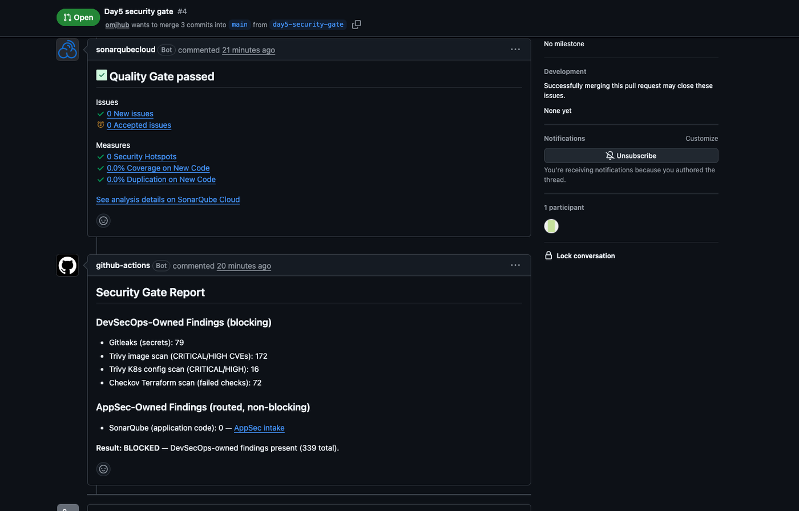
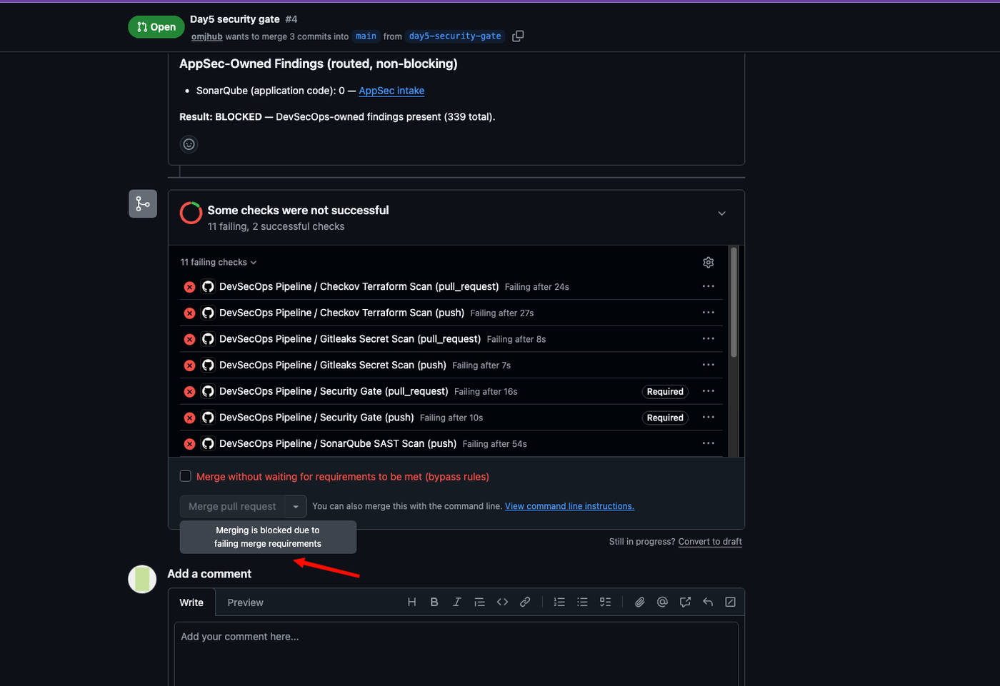
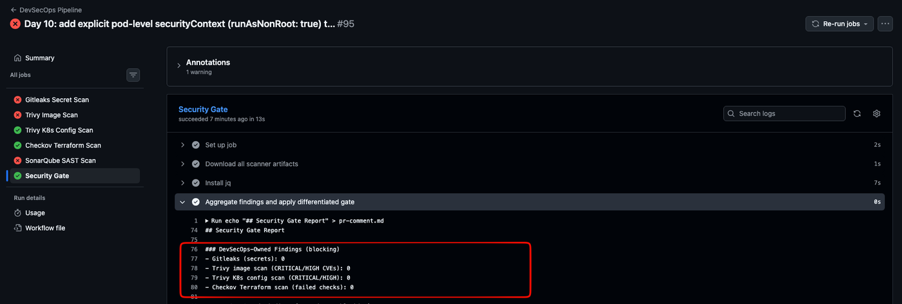
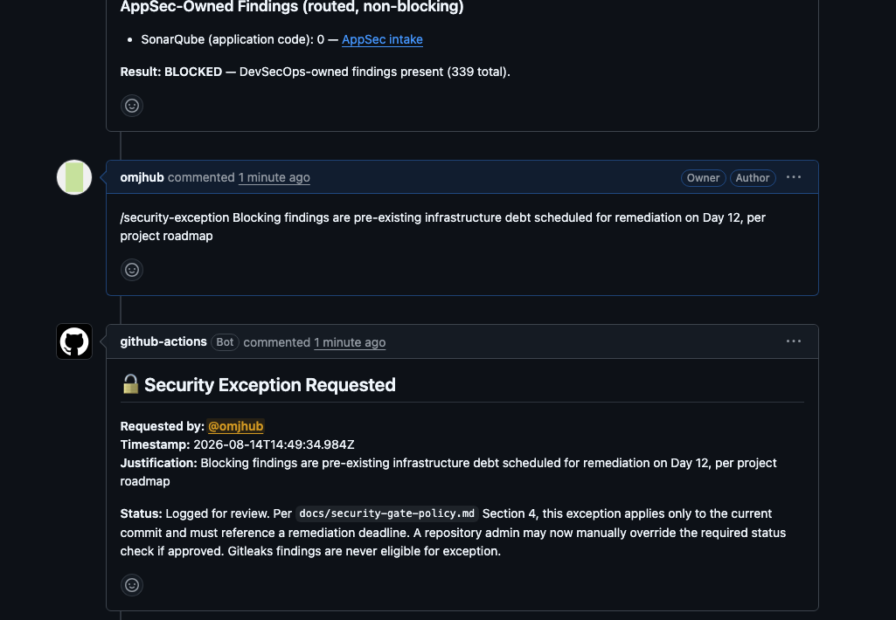
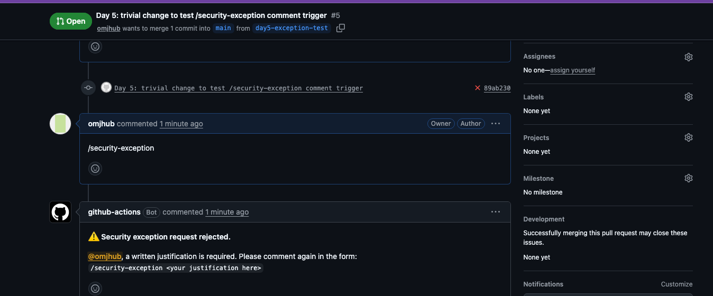
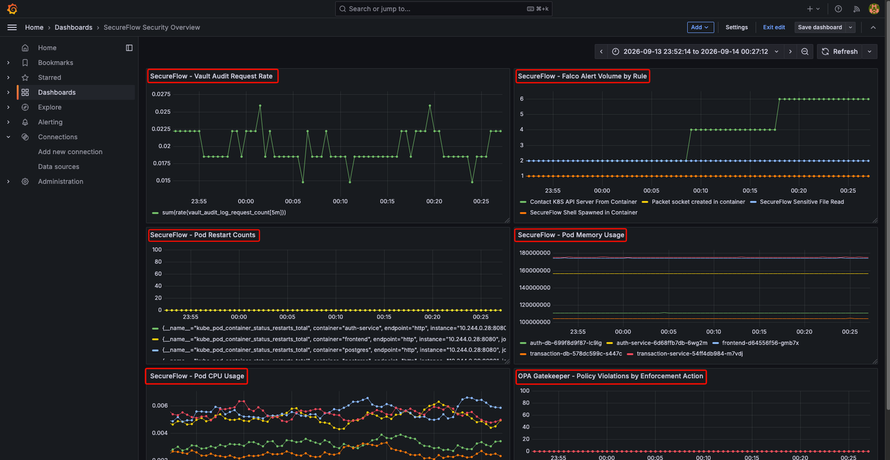
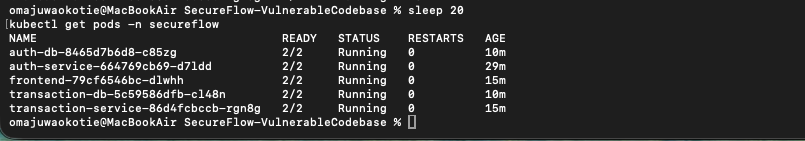

# SecureFlow: Secure CI/CD Pipeline for a Banking Platform


A seven-layer DevSecOps pipeline built around a deliberately vulnerable banking microservices platform (auth, transaction and frontend services). Security is enforced from the first commit to the running cluster: secrets, code, dependencies, images, Kubernetes manifests and Terraform are all scanned in CI, and secrets management, admission control and runtime detection protect the cluster itself.

The pipeline does not just report findings. It applies an **ownership-based security gate**: infrastructure findings owned by DevSecOps block the merge, while application code findings owned by AppSec are routed to a separate intake, the way a real organisation splits responsibility between the two teams.

📄 **[Read the full project report (PDF)](docs/secureflow.pdf)** · 📜 **[Security gate policy](docs/security-gate-policy.md)** · 🧾 **[Vulnerability index](VULNERABILITIES.md)**

---

## Contents

- [Highlights](#highlights)
- [Architecture](#architecture)
- [Pipeline and security gate](#pipeline-and-security-gate)
- [Proof the gate blocks](#proof-the-gate-blocks)
- [Infrastructure remediation: 72 to 0](#infrastructure-remediation-72-to-0)
- [Cluster security controls](#cluster-security-controls)
- [Notable findings](#notable-findings)
- [Results](#results)
- [Evidence log](#evidence-log)
- [Tech stack](#tech-stack)
- [Repository structure](#repository-structure)
- [Running it yourself](#running-it-yourself)
- [Known limitations and roadmap](#known-limitations-and-roadmap)
- [Lessons learned](#lessons-learned)
- [Author](#author)

---

## Highlights

- **72 to 0 Checkov failures** on the Terraform for the AWS environment, with every remaining skip documented and justified in code rather than silently suppressed.
- **From 339 blocking findings to a clean gate.** A live pull request was automatically blocked on 339 DevSecOps-owned findings; after remediation the gate passed with **0** across secrets, image CVEs, Kubernetes manifests and Terraform.
- **Ownership-based security gate.** DevSecOps findings (Gitleaks, Trivy, Checkov) block; AppSec findings (SonarQube, ZAP) are routed without blocking, defined in a written [gate policy](docs/security-gate-policy.md).
- **Auditable exception process.** A `/security-exception <justification>` comment on a pull request is logged by a dedicated workflow; requests without a written justification are rejected.
- **No plaintext secrets in the cluster.** HashiCorp Vault with Kubernetes auth, per-service policies and audit logging.
- **Admission control.** Four OPA Gatekeeper policies block privileged containers, `latest` image tags, missing resource limits and missing labels.
- **Runtime detection.** Falco with custom rules for shell access and sensitive file reads, alerts captured as evidence.
- **Observability.** Prometheus ServiceMonitors for Falco, Gatekeeper and Vault, visualised in Grafana.
- **Full cluster rebuilt from code** after an unplanned loss of the environment, using committed manifests and a rebuild script.

---

## Architecture



**Application:** three Flask and Python services (auth, transaction, frontend) with a database, intentionally seeded with the vulnerabilities listed in [VULNERABILITIES.md](VULNERABILITIES.md).

**Infrastructure as code:** Terraform modules for the AWS target environment (VPC, EKS, IAM, IRSA, RDS, S3), hardened and scanned by Checkov in the pipeline.

**Runtime:** a Kubernetes cluster (kind) running the services with NetworkPolicies, Vault, OPA Gatekeeper, Falco and Prometheus monitoring, rebuilt from [`scripts/rebuild-cluster.sh`](scripts/rebuild-cluster.sh).

---

## Pipeline and security gate

The main workflow ([`devsecops-pipeline.yml`](.github/workflows/devsecops-pipeline.yml)) runs on every push and pull request.

| Layer | Tool | What it checks | Owner | Effect |
| --- | --- | --- | --- | --- |
| 1. Secrets | Gitleaks | Credentials anywhere in Git history | DevSecOps | **Blocks** |
| 2. Code | SonarQube | Application source code (SAST) | AppSec | Routed |
| 3. Dependencies and images | Trivy | CRITICAL and HIGH CVEs in all three images | DevSecOps | **Blocks** |
| 4. Kubernetes config | Trivy | Misconfigured manifests | DevSecOps | **Blocks** |
| 5. Infrastructure | Checkov | Terraform misconfigurations | DevSecOps | **Blocks** |
| 6. Running app | OWASP ZAP | Baseline DAST against the live stack | AppSec | Routed |
| 7. Gate | Security Gate job | Aggregates every report, posts a PR comment, enforces the result | | **Decides** |

In the cluster, **Vault**, **OPA Gatekeeper** and **Falco** add three more layers of protection after deployment (see [Cluster security controls](#cluster-security-controls)).

**Gate design choices** (all written into [`security-gate-policy.md`](docs/security-gate-policy.md)):

- **Ownership over severity.** A single "fail on any CRITICAL" rule either blocks engineers on bugs they cannot fix or lets real infrastructure risk through. Every finding is evaluated by who owns the fix.
- **Unfixable CVEs do not block.** CVEs with no upstream fix (for example base OS packages not yet patched by Debian) are reported but excluded from blocking, because a gate that can never pass gives no remediation signal. CVEs with an available fix always block.
- **Scrubbed history is handled explicitly.** After rewriting Git history to remove real secrets, matches on the literal `REDACTED` placeholder are excluded, verified three times to contain no real values. Genuine historical secrets still count.
- **Every report is kept.** Each scanner uploads its report as an artifact even when its job fails, so a blocked build always leaves the evidence needed to fix it.
- **Exceptions need a reason.** [`security-exception.yml`](.github/workflows/security-exception.yml) logs `/security-exception` requests on pull requests and rejects any without a written justification.

---

## Proof the gate blocks

A gate that has never failed is an assumption. The gate was proven in three stages: blocking, enforcing through branch protection, and finally passing once the DevSecOps-owned findings were remediated.

**1. Blocked.** The first gate run on a pull request into `main` found **339 DevSecOps-owned findings**, including all 72 Checkov failures, and posted its report to the pull request.



**2. Enforced.** Branch protection makes the Security Gate a required check, so the merge button is disabled until it passes.



After the Terraform was hardened, a later run was still blocked on **275 findings**, but with Checkov at **0**: the infrastructure layer was clean, and the remaining findings were in the intentionally vulnerable application code.

```text
DevSecOps-Owned Findings (blocking):
  Gitleaks (secrets): 87
  Trivy image scan (CRITICAL/HIGH CVEs): 175
  Trivy K8s config scan (CRITICAL/HIGH): 13
  Checkov Terraform scan (failed checks): 0
Result: BLOCKED, DevSecOps-owned findings present (275 total)
```

**3. Passed.** After removing secrets from Git history, fixing image CVEs and hardening the Kubernetes manifests, the gate passed with **0 DevSecOps-owned findings** across Gitleaks, Trivy image, Trivy Kubernetes and Checkov. Application code findings from SonarQube and ZAP were routed to AppSec, as the policy defines.



### Exception process in action

A `/security-exception` comment with a written justification is logged with the requester, timestamp and policy reference. A comment without a justification is rejected automatically.

| Logged with justification | Rejected without justification |
| --- | --- |
|  |  |

---

## Infrastructure remediation: 72 to 0

The Terraform started with **72 failing Checkov checks**. Each one was worked through individually rather than suppressed:

| Area | Changes |
| --- | --- |
| **IAM** | Least-privilege managed policies; duplicate `AdministratorAccess` grants removed |
| **EKS** | Private subnets, restricted endpoint access, KMS secrets encryption, full control plane logging, supported Kubernetes version |
| **S3** | Encryption, versioning, access logging, public access blocked, lifecycle rules and event notifications |
| **RDS** | Private subnets, encryption at rest and in transit (forced SSL/TLS), automated backups, deletion protection, Multi-AZ, IAM authentication, CloudWatch logs |
| **IRSA** | OIDC provider with per-service IAM roles, replacing shared node-role permissions |
| **Network** | VPC flow logs, locked-down default security group, explicit KMS key policies |

That brought Checkov to **6 remaining findings**. One was fixed by forcing SSL/TLS on RDS connections. The other five are tool limitations, where the design is correct but Checkov's static check cannot recognise it. Each carries a `checkov:skip` annotation explaining why, documented in [`day08-checkov-final-analysis.md`](evidence/day08-checkov-final-analysis.md).

**Final state: 72 to 0, with every skip justified in code.**

---

## Cluster security controls

| Control | Implementation |
| --- | --- |
| **Secrets management** | HashiCorp Vault with Kubernetes auth, per-service policies and roles, and audit logging ([audit log](evidence/day06-vault-audit-log.json)) |
| **Admission control** | OPA Gatekeeper ConstraintTemplates and Constraints: [no privileged containers](infra/kubernetes/gatekeeper/no-privileged-constraint.yaml), [no `latest` tags](infra/kubernetes/gatekeeper/no-latest-tag-constraint.yaml), [resource limits required](infra/kubernetes/gatekeeper/require-resources-constraint.yaml), [labels required](infra/kubernetes/gatekeeper/require-labels-constraint.yaml) |
| **Runtime detection** | Falco (modern eBPF) with [custom rules](infra/kubernetes/falco/custom-rules.yaml) for shell spawning and sensitive file reads ([alerts captured](evidence/day08/falco-alerts-captured.json)) |
| **Network isolation** | Kubernetes NetworkPolicies applied with the base manifests |
| **Monitoring** | Prometheus [ServiceMonitors](infra/kubernetes/monitoring) for Falco, Gatekeeper and Vault, visualised in Grafana |

**SecureFlow Security Overview in Grafana:** Vault audit request rate, Falco alerts by rule, pod restarts, memory and CPU, and OPA Gatekeeper policy violations by enforcement action.



**Hardened workloads running:** every service and database pod runs with a Vault Agent sidecar (2/2) and an explicit non-root security context.



---

## Notable findings

**CRITICAL: live Werkzeug interactive debugger exposed.** During an authenticated OWASP ZAP scan, crawl results pointed to debugger stack-trace pages. Manual verification confirmed the Werkzeug debugger JavaScript was served unauthenticated, meaning a remote Python console was reachable behind a PIN. Severity was raised to Critical and the finding documented without attempting the PIN, staying within scope. Full write-up: [`day10-zap-critical-finding.md`](evidence/day10-zap-critical-finding.md).

**Unplanned full cluster loss.** The entire local cluster was removed by an external cause. It was rebuilt from committed manifests and documented procedures (images, NetworkPolicies, Vault configuration, all Gatekeeper policies and Falco rules), and two new issues found during recovery were diagnosed and fixed. Write-up: [`day09-disaster-recovery.md`](evidence/day09-disaster-recovery.md).

---

## Results

| Metric | Before | After |
| --- | :---: | :---: |
| Checkov failures on Terraform | 72 | **0** (every skip justified) |
| Security layers enforced | 0 | **7 in CI + 3 in cluster** |
| Gate behaviour | None | **Ownership-based, blocking for DevSecOps findings** |
| DevSecOps-owned findings at the gate | 339 | **0 (gate passed)** |
| Pull request with planted vulnerabilities | Would merge | **Blocked by required checks** |
| Secrets in cluster config | Plaintext | **Vault, audited** |
| Admission policies | None | **4 OPA Gatekeeper policies** |
| Runtime detection | None | **Falco with custom rules** |
| Exception handling | Ad hoc | **Logged, justification required** |

---

## Evidence log

Every stage of the work is backed by raw scanner output and written analysis in [`evidence/`](evidence):

| Day | Evidence |
| --- | --- |
| 3 | SonarQube findings ([CSV](evidence/day03-sonarqube-findings.csv), [JSON](evidence/day03-sonarqube-findings.json)) |
| 4 | Trivy baseline per image and K8s report, [unified findings table](evidence/day04-master-table-unified.md), [K8s findings mapping](evidence/day04-k8s-findings-mapping.md) |
| 6 | [Vault audit log](evidence/day06-vault-audit-log.json) |
| 7 | [Gitleaks final analysis](evidence/day07-gitleaks-final-analysis.md), post-remediation Trivy scans, [secret verification](evidence/day07/secret-verification-clean.txt) |
| 8 | [Checkov final analysis](evidence/day08-checkov-final-analysis.md), [Falco analysis](evidence/day08-falco-analysis.md), [image pinning limitation](evidence/day08-image-pinning-limitation.md) |
| 9 | [Disaster recovery](evidence/day09-disaster-recovery.md) |
| 10 | [ZAP critical finding](evidence/day10-zap-critical-finding.md) |

---

## Tech stack

| Area | Tools |
| --- | --- |
| CI/CD | GitHub Actions |
| Secret scanning | Gitleaks |
| SAST | SonarQube |
| Image and config scanning | Trivy |
| IaC scanning | Checkov |
| DAST | OWASP ZAP |
| Secrets management | HashiCorp Vault |
| Admission control | OPA Gatekeeper |
| Runtime security | Falco (modern eBPF) |
| Observability | Prometheus, Grafana |
| Infrastructure as code | Terraform (AWS: VPC, EKS, IAM, IRSA, RDS, S3) |
| Runtime | Kubernetes (kind), Docker, Docker Compose |
| Application | Python, Flask |

---

## Repository structure

```
.
├── .github/workflows/
│   ├── devsecops-pipeline.yml   # Scanners, ZAP and the ownership-based security gate
│   └── security-exception.yml   # Logs /security-exception requests on PRs
├── services/                    # auth-service, transaction-service, frontend (intentionally vulnerable)
├── db/                          # Database initialisation
├── infra/
│   ├── terraform/               # main.tf and modules: vpc, eks, iam, irsa, rds, s3
│   └── kubernetes/              # base, overlays, gatekeeper, falco, monitoring
├── scripts/rebuild-cluster.sh   # Recreate the full cluster from code
├── evidence/                    # Raw scanner output and day-by-day analysis
├── docs/                        # Project report, gate policy, progress report
├── VULNERABILITIES.md           # Index of planted vulnerabilities
└── docker-compose.yml           # Local application stack
```

---

## Running it yourself

**Run the application locally** (requires Docker):

```bash
docker compose up -d
# Frontend on http://localhost:5000
docker compose down
```

**Rebuild the Kubernetes environment** (requires Docker, kind, kubectl and Helm):

```bash
./scripts/rebuild-cluster.sh
```

This creates the kind cluster, builds and loads the images, applies the manifests and NetworkPolicies, and installs Vault, OPA Gatekeeper and Falco.

**Pipeline configuration:** set `SONAR_TOKEN` and `SONAR_HOST_URL` as repository secrets for the SonarQube job.

> ⚠️ The services are **intentionally vulnerable**. Run them only locally or in an isolated environment.

---

## Known limitations and roadmap

| Priority | Item | Plan |
| --- | --- | --- |
| High | AppSec-owned code findings (SonarQube, ZAP) are routed, not yet fixed | Remediate the application vulnerabilities in [VULNERABILITIES.md](VULNERABILITIES.md), including the exposed Werkzeug debugger |
| Medium | One custom Falco rule (shell spawned) does not fire independently | Shell access is still detected by Falco's built-in rule; isolate and debug with verbose rule diagnostics ([analysis](evidence/day08-falco-analysis.md)) |
| Medium | Images pinned by tag, not digest | Pin by digest and add image signing ([limitation](evidence/day08-image-pinning-limitation.md)) |
| Low | Runtime controls validated on kind | Apply the hardened Terraform and run the same controls on Amazon EKS |

---

## Lessons learned

- **A gate needs a policy, not just thresholds.** Deciding who owns each finding made the gate both stricter on infrastructure and fairer to developers.
- **Fixing beats suppressing.** Working through 72 Checkov failures one by one produced real hardening and a short, defensible list of documented exceptions.
- **Rebuildable beats careful.** Losing the whole cluster cost hours, not days, because everything was in code.
- **Verify before you report.** The ZAP debugger finding was confirmed manually, and an initial false negative caused by Docker DNS was caught by re-testing.

---

## Author

**Omajuwa Okotie**, DevSecOps and Cloud Security Engineer

Delivered end to end from an industry client brief through AMDARI. The base application was provided as an intentionally vulnerable codebase; the CI/CD architecture, security gate and policy, scanner integrations, infrastructure remediation, cluster security controls and evidence are my own work.

[Portfolio](https://omajuwaokotie.com) · [LinkedIn](https://www.linkedin.com/in/omajuwa-okotie-850950190) · [GitHub](https://github.com/omjhub)
